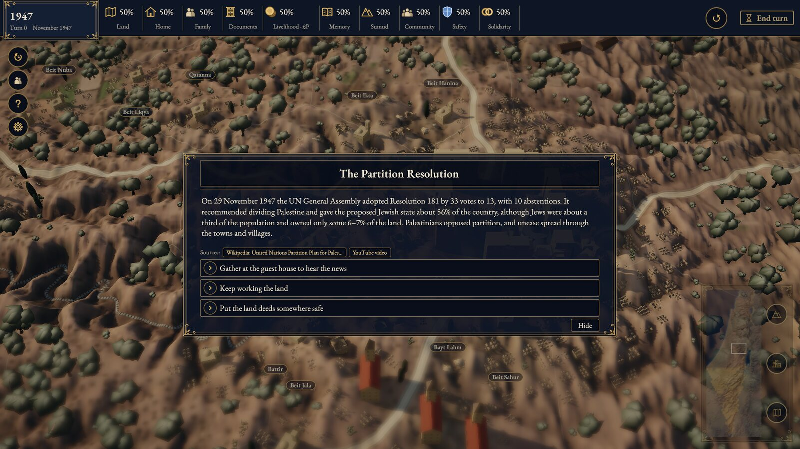
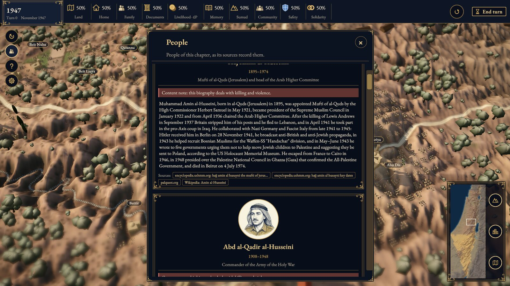
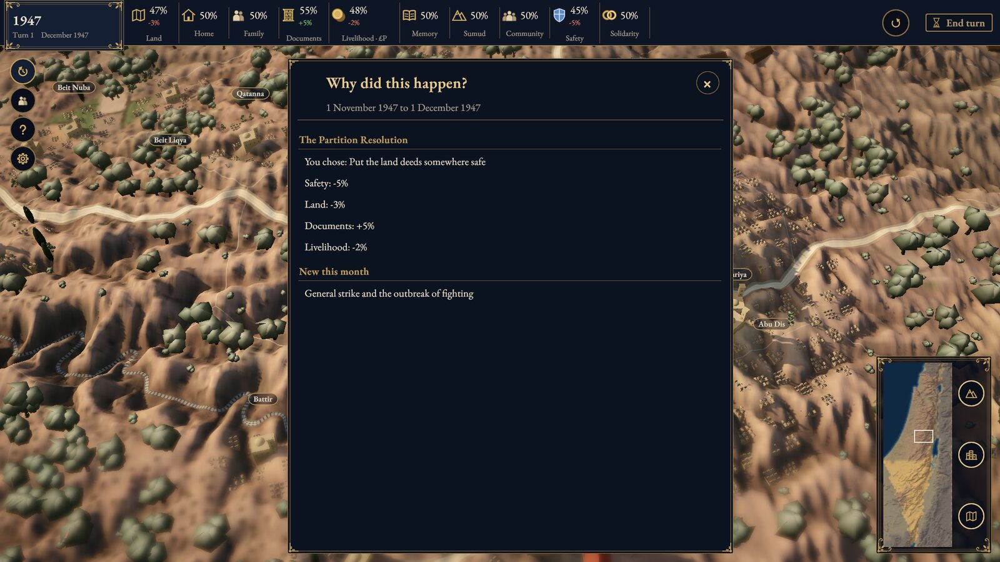
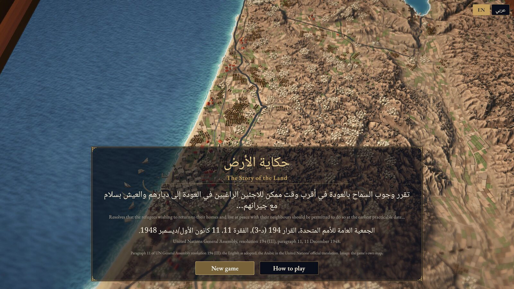
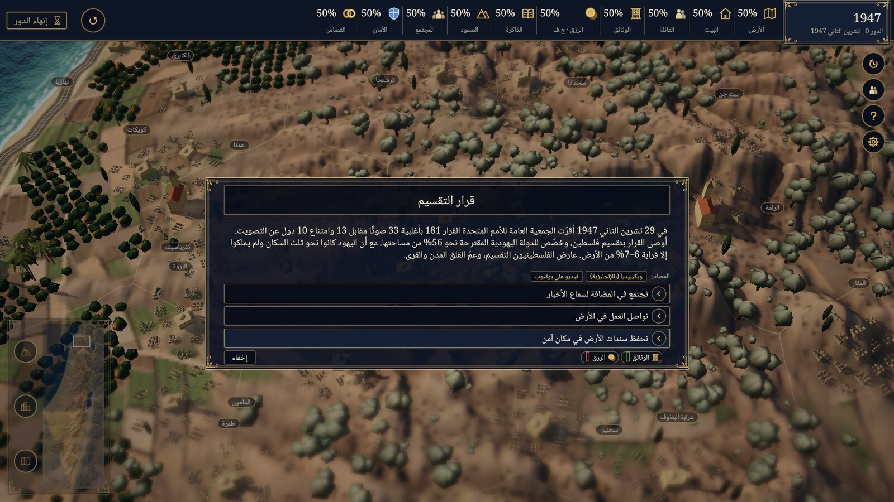

# The Story of the Land (حكاية الأرض)

<p align="center"><b>A strategy game about the history of Palestine, told from the Palestinian side.</b><br>
Keep one family and its village on the land, month by month, from 1880 to 2026.</p>

<p align="center">By Mohamed Jbilou.</p>

<p align="center">
  <a href="#trailer">Trailer</a> ·
  <a href="#the-game">The game</a> ·
  <a href="#how-it-plays">How it plays</a> ·
  <a href="#build-from-source">Build</a> ·
  <a href="#license">License</a>
</p>

<p align="center">
  <a href="LICENSE"></a>
  <a href="THIRD-PARTY-NOTICES.md"></a>
  <a href="unity/ProjectSettings/ProjectVersion.txt"></a>
  
</p>

> [!NOTE]
> The game is non-commercial. It deals with displacement, occupation and war as historical events. Every
> fact cites a source, no quote is invented, and contested claims are marked as contested. The work is in progress
> ([docs/PLAN.md](docs/PLAN.md)).

## Trailer

https://github.com/user-attachments/assets/66c39321-d4b7-40f2-8318-93ea38bd1f91

<p align="center"><sub>1:20 with sound. The miniature-world shots and the music are AI-generated; the game screens are
from the current build. <a href="https://medjbilou.github.io/the-story-of-the-land/">Watch in 1080p</a>.</sub></p>

## The game

<table>
  <tr>
    <td colspan="2"></td>
  </tr>
  <tr>
    <td colspan="2" align="center"><sub><b>A card.</b> Each event that reaches the family, with its sources and the choices it leaves you.</sub></td>
  </tr>
  <tr>
    <td width="50%"></td>
    <td width="50%"></td>
  </tr>
  <tr>
    <td align="center"><sub><b>People.</b> 54 figures, each with a sourced biography and a portrait.</sub></td>
    <td align="center"><sub><b>Why.</b> What your choice changed, resource by resource.</sub></td>
  </tr>
  <tr>
    <td width="50%"></td>
    <td width="50%"></td>
  </tr>
  <tr>
    <td align="center"><sub><b>Start.</b> Pick a chapter and a village.</sub></td>
    <td align="center"><sub><b>Arabic.</b> The whole game, mirrored right to left.</sub></td>
  </tr>
</table>

## How it plays

1. Pick one of seven chapters, from late Ottoman Palestine to October 2026, and a village.
2. Each month, read the events that reached your family: a strike, a land sale, an expulsion order, a siege.
3. Choose what the family does. The choice moves ten resources: Land, Home, Family, Documents, Livelihood, Memory,
   Sumud, Community, Safety and Solidarity.
4. Keep the family's claim to the land alive through memory, documents, sumud and return.

## What makes it different

- **Palestinian side.** Every card says what came before an event and who acted. The occupation's violence is never
  called a "response"; Israeli state and army statements appear as claims ([docs/CONTENT_POLICY.md](docs/CONTENT_POLICY.md)).
- **Sourced.** 303 events, each linked to its sources: the UN, rights groups, palquest.org, Al Jazeera. Every death
  toll says who counted it.
- **A map that changes.** The 1948 village fates; from 1967 the occupation, the settlements, Oslo, the wall; from
  October 2023 the destruction of Gaza, month by month, from UNOSAT's satellite surveys.
- **Checked footage.** Clips from Archive Genocide, Al Jazeera, Middle East Eye and the UN, shown after a content note
  and only once a person has signed them off ([docs/footage-review.md](docs/footage-review.md)).
- **Arabic and English,** with narration and music.

Underneath, a deterministic C# simulation (`sim/`) runs the rules: the same choices always give the same result
([docs/determinism.md](docs/determinism.md)). Unity draws a 3D terrain map from real elevation data.

## Status

| Done | Open |
|---|---|
| The simulation, the map and the Unity project; macOS, Windows, Linux and web builds | A native Palestinian Arabic editor's read |
| Seven chapters and 54 people, written from the Palestinian side, in Arabic and English | Frame-rate tuning |
| Narration, music, the occupation and Gaza's destruction on the map, checked footage | |

The plan is in [docs/PLAN.md](docs/PLAN.md).

## Build from source

You need Unity **6000.6.6f1** exactly; the version and changeset are in
[`unity/ProjectSettings/ProjectVersion.txt`](unity/ProjectSettings/ProjectVersion.txt). You also need .NET SDK 10 and
[uv](https://github.com/astral-sh/uv). Your Unity licence must be active in Unity Hub before any batch command.

```bash
uv run tools/build_sim_for_unity.py      # the sim DLLs Unity loads (build output, not committed)
export UNITY="/Applications/Unity/Hub/Editor/6000.6.6f1/Unity.app/Contents/MacOS/Unity"

# macOS player (Mono backend; no Mac IL2CPP module needed) -> unity/Builds/Mac/TheStoryOfTheLand.app
"$UNITY" -batchmode -CI false -GITHUB_ACTIONS false -TF_BUILD false -quit -projectPath unity \
  -buildTarget OSXUniversal -executeMethod StoryOfTheLand.Game.EditorTools.Build.MacMono -logFile "$PWD/unity-build-mac.log"

# Browser build (needs Web Build Support), then serve it
"$UNITY" -batchmode -CI false -GITHUB_ACTIONS false -TF_BUILD false -quit -projectPath unity \
  -buildTarget WebGL -executeMethod StoryOfTheLand.Game.EditorTools.Build.Web -compression disabled -logFile "$PWD/unity-build-web.log"
python3 -m http.server 8000 --directory unity/Builds/Web-disabled   # then open http://localhost:8000/
```

`Build.LinuxMono` and `Build.WindowsMono` build the other desktop players the same way. A build rewrites some cached
settings; drop them afterwards with `git checkout -- unity/Assets/Settings unity/ProjectSettings/ProjectSettings.asset`.
More detail is in [BUILDING.md](BUILDING.md).

**First open in Unity.** Unity Hub → **Add** → select `unity/`. The game scene is `Assets/Map.unity`, and it opens
automatically. If it doesn't (you see an empty "Untitled" scene), double-click `Map` in the Project window's Assets
folder, then press Play. Run `uv run tools/build_sim_for_unity.py` again after every change under `sim/`. Unity can't
run while there is any compile error.

**Screenshot mode.** A desktop player started with `-shot` captures the map and quits. It needs a focused window, so
start it as a new instance: `open -n TheStoryOfTheLand.app --args -shot`.

## AI use

Nothing is generated while you play. Made with AI, offline, and disclosed in [docs/ai-disclosure.md](docs/ai-disclosure.md):

| Part | How |
|---|---|
| Code and text | Written with AI coding agents, checked by tests and review; every fact checked against its source |
| Narration | Stock synthetic voices (Habibi-TTS, Apache-2.0; Chatterbox Multilingual, MIT); no real voice cloned |
| Portraits | Ink-and-wash drawings (Gemini); a symbolic still life where no photo of the person exists |
| Music | Google Lyria: a main theme, four era themes and a war theme |
| 3D models | AI-generated by Tal Heuberger (Tripo Studio) |
| Trailer | Miniature-world shots and music (Veo, Lyria); the game screens are real |

## License

| Part | License |
|---|---|
| Code | [MIT](LICENSE) |
| Art, UI, shaders and docs | [CC BY 4.0](LICENSES/CC-BY-4.0.txt) |
| Game text and map data (`content/`, many paraphrased from Wikipedia) | [CC BY-SA 4.0](LICENSES/CC-BY-SA-4.0.txt) |
| AI images, AI music, 3D models by Tal Heuberger | [CC0](LICENSES/CC0-1.0.txt) |
| Map layers | UN OCHA, the Palestinian Ministry of Planning, the Gaza Housing Council and Peace Now via HDX (CC BY 4.0 / CC BY-IGO); UNOSAT (CC BY-SA); Wikidata (CC0). The Oslo areas file's licence is still being checked. |
| Fonts | EB Garamond, Amiri, Noto Naskh Arabic: SIL Open Font License 1.1 |
| Terrain | Derived from Copernicus GLO-30 (notice in [NOTICE](NOTICE)) |

The Unity engine and packages are under their own terms. Licences by path and every notice are in
[THIRD-PARTY-NOTICES.md](THIRD-PARTY-NOTICES.md), data attributions in [NOTICE](NOTICE), each image's source in
[ASSETS.yaml](ASSETS.yaml), and the in-game credits in [docs/credits.md](docs/credits.md).

## Credits

Each fact's sources are listed with it in `content/`; third-party credits are in
[THIRD-PARTY-NOTICES.md](THIRD-PARTY-NOTICES.md).
